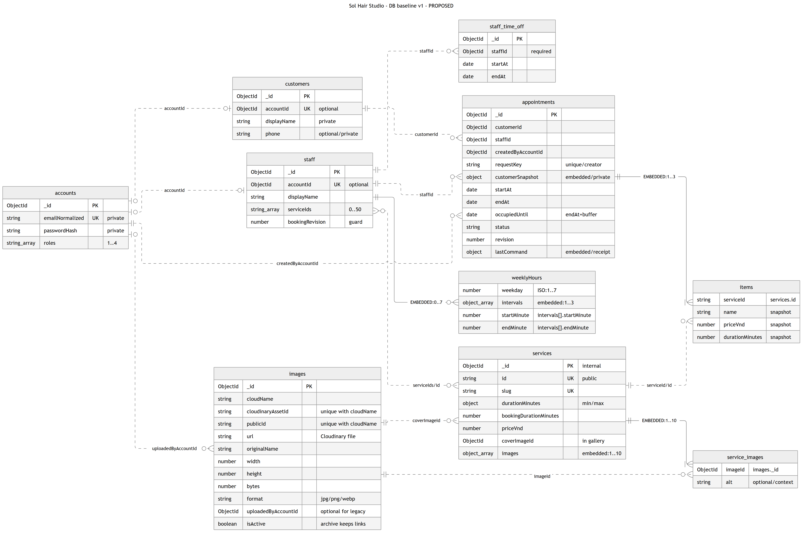

# SOL-016 — DB baseline MVP

Cập nhật **14/10/2026** từ SOL-011 theo [PHẠM VI đã chốt](https://docs.google.com/spreadsheets/d/1mKBFo0c1PcSJEVwbI80AAsorL47a7VyGk-nE0hIGLbw/edit?gid=785319952#gid=785319952). BR sản phẩm đã được chủ dự án duyệt; baseline kỹ thuật nghiệm thu qua PR SOL-016. **Chưa triển khai model/API hoặc áp dụng validator/index/migration lên DB thật.**

## Đọc từ đây



1. [Đối chiếu baseline cũ → scope MVP và ranh giới module](scope-alignment.md).
2. [Schema](schema.md), [quy tắc ghi/đồng thời](business-rules.md), [query/index](queries-and-indexes.md).
3. [Mẫu giả](examples/README.md), [chuyển đổi có điều kiện](migration-plan.md), [bằng chứng và giới hạn](review.md).
4. [Nguồn/sơ đồ chỉnh sửa được](diagrams/README.md).

## Nền được giữ lại

- Monorepo JS/JSX, Express/Mongoose, MongoDB, Cloudinary. Runtime đối chiếu `main` tại `69b325f` (PR #15); Home/danh mục web và Android đã có, auth/booking chưa triển khai.
- Giữ services.id String, snapshot dịch vụ nhúng trong lịch, reference hồ sơ và transaction ghi guard trước kiểm tra xung đột.
- Giữ chính xác DTO GET /api/services: `{data:[{id,slug,name,description,category,durationMinutes,priceVnd,imageUrl}]}`. Runtime còn projection loại trừ; task code phải đổi allowlist trước khi thêm field DB.
- Giữ metadata images và tài sản đã có; MVP chỉ cần chủ upload/chọn ảnh dịch vụ. Kho ảnh tổng, gallery editor/archive/purge của SOL-011 không trở thành yêu cầu MVP.

## Collection và chủ sở hữu

| Collection | Module ghi chính | Mục đích |
| --- | --- | --- |
| services, images | M2 | Danh mục, thời lượng cố định, ảnh; giữ DTO cũ |
| accounts, auth_challenges | M1 | Ba role, kích hoạt/reset OTP, cấp mật khẩu nhân viên |
| customers | M1 tạo hồ sơ khách; M4 tạo vãng lai | Một mã hồ sơ, phone không unique; cập nhật dùng cùng guard |
| staff, staff_shifts, staff_time_off | M3 | Chủ kiêm stylist, ca theo ngày thực tế, nghỉ ngoại lệ do chủ quản lý |
| appointments, booking_requests | M4 tạo; M5 chuyển trạng thái | Một nguồn lịch; receipt idempotency 24 giờ |
| appointment_events | M4/M5 trong transaction lịch | Audit append-only, không nhúng mảng lịch sử tăng mãi |

Đây là 11 collection thiết kế đích, không phải đã tồn tại. staff_time_off giữ nghỉ ngoại lệ từ baseline cũ, không có yêu cầu/duyệt nghỉ của nhân viên. Không thêm slot/lease/service phân tán hoặc collection sao chép lịch.

## Các mốc đã chốt

Một tiệm, không lễ tân; khách Web + Mobile, chủ Web, stylist Mobile. 1–5 dịch vụ/một stylist; tổng giá/thời lượng lúc đặt, dọn 10 phút; bước giờ 15 phút, khách trước ≥30 phút, tối đa 7 ngày. Chủ đặt khách tới ngay dùng giờ thực tế server. Tự xác nhận khi commit; chỉ ngày đã có ca được mở booking. Khách đổi/hủy trước ≥2 giờ; no-show sau 15 phút và đã liên hệ. Xong sớm mở giờ sau dọn; ETA kéo dài chỉ cảnh báo. Chỉ chủ sửa nhầm hai trường hợp có lý do/audit. OTP 6 số/5 phút/60 giây/5 lần sai; receipt tạo lịch 24 giờ.

## Kiểm tra và bàn giao

```powershell
node docs/database/checks/validate-examples.mjs --self-test
```

Checker chỉ đọc file/mẫu giả, không import app, đọc .env, gọi mạng hoặc kết nối DB. Không chứng minh transaction/TTL/mail/upload thật. Mỗi module triển khai code trong task riêng; không chờ bộ document API hoàn chỉnh, nhưng dùng cùng schema/fixtures trước tích hợp.

Nguồn: [SOL-016](https://docs.google.com/spreadsheets/d/1mKBFo0c1PcSJEVwbI80AAsorL47a7VyGk-nE0hIGLbw/edit?gid=0#gid=0&range=A15:O15), [kiến trúc runtime](../kien-truc-va-luong-chay.md), [phạm vi môn học](../course-scope.md). Rubric vẫn đối chiếu riêng; mục tiêu nội bộ 01/11/2026 và demo Web + Android không phải tuyên bố đạt rubric.
