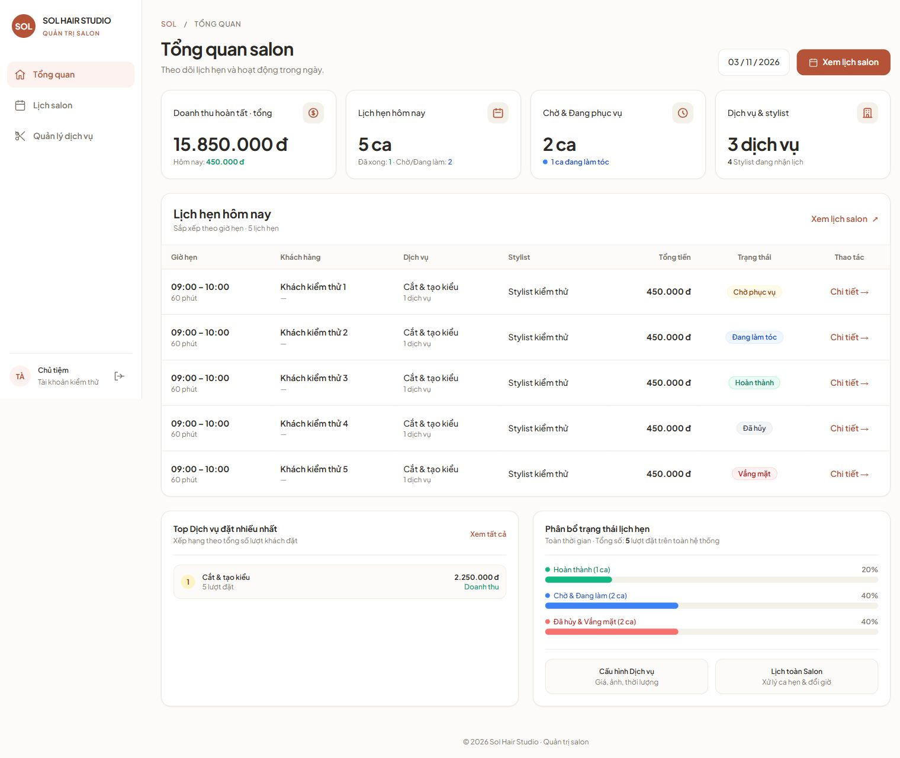

# Admin dashboard UI refinement

Implemented from the approved terracotta/ivory mockup. Task mapping: Chờ đối chiếu sau audit website. [Planning Sheet](https://docs.google.com/spreadsheets/d/1mKBFo0c1PcSJEVwbI80AAsorL47a7VyGk-nE0hIGLbw/edit).

## Scope and compatibility

- Shared EJS sidebar for dashboard, services and appointment pages; compact three-item navigation on narrow screens, active-page semantics, keyboard skip link, existing POST logout.
- Clearer dashboard hierarchy, larger metrics and appointment rows, restrained status colors, retained empty state and lower analytics sections.
- Existing total revenue remains total revenue, with today's revenue beneath it. All existing customer, phone, time, duration, service, stylist, amount, status and detail links remain rendered from the same server values.
- No changes to controllers, services, database queries, auth, API contracts, mobile, or dependencies. No mockup sample data is shipped. Mockup-only search, tabs, pagination and interactive date selection are not added.
- Removed static “live” / “system healthy” claims that were not backed by dashboard polling or health data.

## Browser evidence

Checked Chrome on the running local application: real-data empty dashboard, navigation to Services and Salon appointments, then back to dashboard. Read-only inspection; no production data or credentials included here.

Rendered the same EJS template in an isolated localhost preview with synthetic data to inspect all five appointment statuses and populated amounts. This preview does not connect to a database and is not application code.

At a 390 × 844 CSS viewport, all three navigation items remain accessible; the 900px appointment table scrolls within its 342px container rather than widening the page (document width 375px). Restored the normal browser viewport afterwards. No native emulator or physical device tested.

Existing Tailwind CDN and Google Fonts dependencies are retained.
