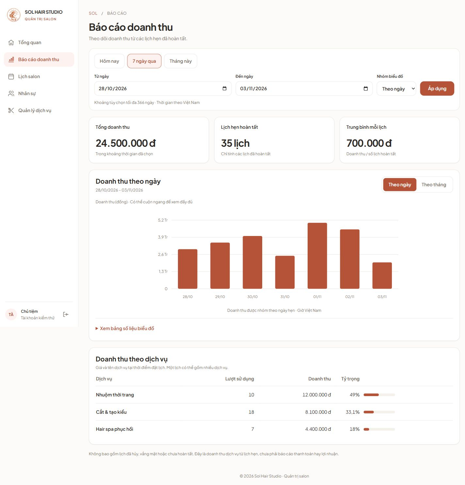

# Báo cáo doanh thu admin

Route EJS: `/admin/revenue`, chỉ owner truy cập. Sidebar đặt ngay sau Tổng quan.

- Lọc Hôm nay, 7 ngày qua (gồm hôm nay), Tháng này (đến hôm nay), hoặc khoảng tùy chọn tối đa 366 ngày; nhóm theo ngày/tháng.
- Chỉ tính lịch `completed`, lọc và nhóm theo `localDate` ngày hẹn tại Việt Nam, nhất quán với dashboard. Không tính theo ngày thanh toán hoặc thời điểm chuyển trạng thái hoàn tất.
- Tổng từ `totalPriceVnd`; số lịch hoàn tất; trung bình làm tròn đến đồng. Dịch vụ tổng hợp theo `serviceId` và giá snapshot `items.priceVnd`, giữ tên snapshot. Một lịch có thể có nhiều dịch vụ nên lượt sử dụng dịch vụ không nhất thiết bằng số lịch.
- Điền 0 cho ngày/tháng không có doanh thu; bảng số liệu biểu đồ có thể mở để đọc bằng bàn phím/trình đọc màn hình. Trường hợp có lịch miễn phí vẫn hiển thị số lịch và biểu đồ 0.
- Empty và lỗi database có thông báo khác nhau; lỗi không giả lập số liệu 0. Query không hợp lệ trả 400 trước khi truy vấn database. Không thêm dependency, JSON endpoint, schema hoặc thay đổi hợp đồng API/mobile.

## Bằng chứng

- `npm run lint --workspace @sol-hair/api`: đạt.
- `npm run test --workspace @sol-hair/api -- src/modules/admin/tests/revenue.test.js src/modules/admin/tests/admin.routes.test.js src/routes/tests/admin.routes.test.js`: 35 test đạt.
- Kiểm tra Node trực tiếp với MongoMemoryServer 8.0.17 tạm: lịch hoàn tất trong 01–03/11/2026 cho tổng 900.000 đ / 2 lịch / trung bình 450.000 đ; bỏ lịch hủy và lịch ngoài khoảng; 02/11 có 0; tổng dịch vụ bằng tổng lịch; nhóm tháng vẫn 900.000 đ. Database tạm đã đóng/xóa; không ghi database thật.
- Chrome localhost: dữ liệu hiện có chưa có lịch hoàn tất trong kỳ, hiển thị empty; click Tháng này, đổi Theo tháng và submit ngày tùy chọn hoạt động. Kiểm tra 390×844 (ô ngày rộng 308px, page 375px trong viewport 390px), desktop 1440×1000. Không kiểm native hoặc thiết bị thật.
- Ảnh dưới render chính template EJS với dữ liệu tổng hợp trong server preview riêng, không phải dữ liệu thật hoặc dữ liệu hardcode trong sản phẩm.
- Không chạy toàn bộ test/build local theo ưu tiên kiểm tra tập trung; CI vẫn giữ nguyên.

Chờ đối chiếu sau audit website — [Sheet phân công](https://docs.google.com/spreadsheets/d/1mKBFo0c1PcSJEVwbI80AAsorL47a7VyGk-nE0hIGLbw/edit). Chưa cập nhật Sheet, chưa gán người làm hoặc ngày hoàn thành. Nhánh dựa trên PR #56 còn mở; không merge khi chưa có yêu cầu.
