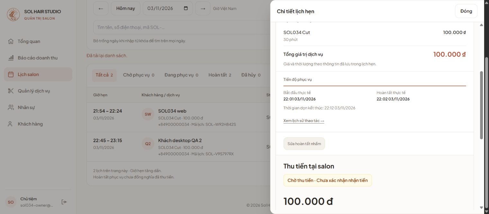
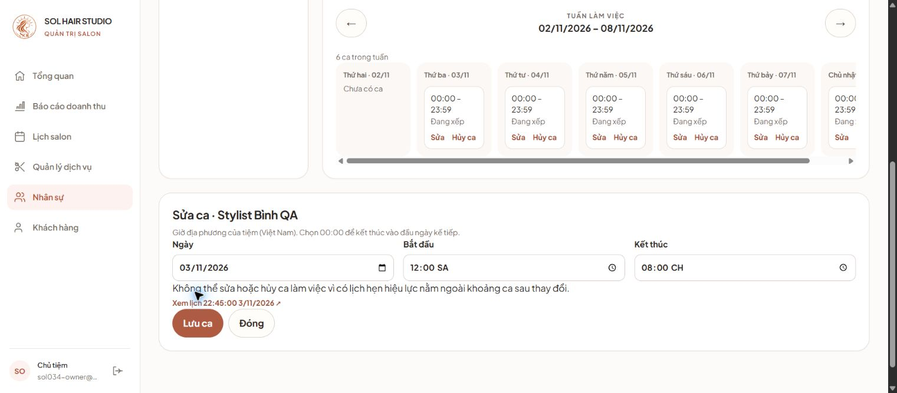
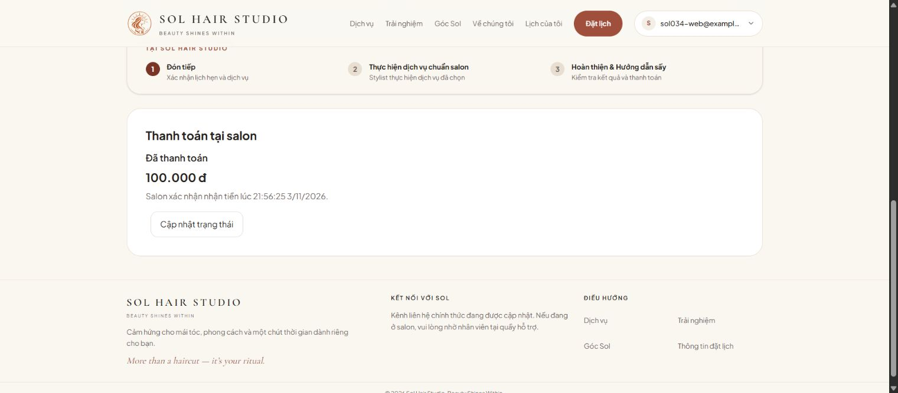

# Refine customer và admin trên desktop

Phạm vi: web desktop theo audit ngày 03/11/2026; không triển khai UI mobile. Chờ đối chiếu sau audit website với [Sheet phân công](https://docs.google.com/spreadsheets/d/1mKBFo0c1PcSJEVwbI80AAsorL47a7VyGk-nE0hIGLbw/edit). Đây là bằng chứng triển khai, không phải backlog hoặc xác nhận đã nghiệm thu/merge.

## Điều hướng và thay đổi

| Luồng | Kết quả |
| --- | --- |
| Admin → Lịch salon → Đặt lịch cho khách | Chọn rõ hồ sơ khi trùng số điện thoại, hoặc nhập khách vãng lai; dịch vụ → giờ/stylist → kiểm tra → xác nhận. Hỗ trợ khách đến ngay. |
| Admin → chi tiết lịch | Panel bên phải; chủ tiệm có thể bắt đầu/hoàn tất trên lịch toàn salon; tải lại trạng thái và bảng sau thao tác. |
| Admin → Nhân sự | Sửa hồ sơ, dịch vụ và trạng thái; giữ dữ liệu sửa ca khi xung đột, liên kết đến lịch bị ảnh hưởng; sửa tràn chiều ngang. |
| Admin → Dịch vụ | Dialog có tên truy cập, vùng cuộn, nút đóng và khu vực thao tác rõ ràng. |
| Admin → Tổng quan | Dịch vụ phổ biến chỉ tính lịch hoàn tất, phân biệt giá trị dịch vụ với tiền đã thu. |
| Customer → Tài khoản | Sửa tên/số điện thoại; cũng mở được từ đặt lịch mà giữ dịch vụ đang chọn. |
| Customer → Đặt lịch | Nhóm giờ sáng/chiều/tối; thông tin hồ sơ và tóm tắt rõ hơn. |
| Customer → Lịch của tôi | Mã SOL, trạng thái thanh toán, mục Cần chú ý gồm lịch hoàn tất chưa trả; nội dung khóa thao tác theo trạng thái. |
| Customer → Chi tiết → QR | Đọc lại trạng thái trước khi mở; sao chép số tiền/nội dung; tự đóng khi đã thu tiền, hướng dẫn không chuyển lần hai. |

## Hợp đồng API và cấu hình

- Danh sách lịch customer thêm `paymentStatus: paid | unpaid`, không trả người thu tiền hoặc dữ liệu payment nội bộ. Là trường bổ sung, mobile hiện có không phải đổi request.
- `POST /api/staff` cho phép owner đang hoạt động tạo hồ sơ phục vụ gắn chính tài khoản mình bằng email của mình. Không đổi role, không tạo thông tin đăng nhập mới, không gắn tài khoản của người khác. Kiểm tra owner và dịch vụ trong transaction; unique index ngăn hồ sơ trùng.
- Admin đặt lịch dùng API availability/appointments và idempotency hiện có. Khi kết quả ghi chưa xác định, khóa dữ liệu và retry cùng payload/key; không tạo yêu cầu mới.
- Cấu hình `VITE_SALON_PHONE` (8–15 chữ số, có thể bắt đầu bằng `+`) và `VITE_SALON_ADDRESS` bằng thông tin chủ salon xác nhận. Chưa có cấu hình thì không hiển thị hotline/địa chỉ giả.

## Bằng chứng chạy thật

Chrome desktop, Express thật và MongoDB 8.0.17 replica set tạm; toàn bộ tài khoản/lịch là dữ liệu tổng hợp. Đã chạy đăng nhập hai vai trò, chọn hồ sơ trùng số điện thoại, admin walk-in, customer đặt lịch, admin khách vãng lai hẹn giờ, bắt đầu/hoàn tất, sửa hồ sơ customer trong và ngoài booking, sửa nhân viên/ca bị xung đột, sửa giá dịch vụ và đóng dialog bằng Escape.

Ca QR: mở bằng customer, xác nhận thu tiền bằng API owner trên fixture để không thay phiên customer; quan sát QR tự đóng sau polling. Không chuyển khoản ngân hàng thật. Ca retry mất kết nối được kiểm tra bằng browser-state test (Happy DOM), không coi đó là bằng chứng Chrome mất mạng. Tạo hồ sơ phục vụ của owner được kiểm tra tích hợp API, chưa chạy thao tác đó trên Chrome.

Không chạy thiết bị/emulator, SMTP hoặc upload Cloudinary. Build mobile chỉ kiểm tra tương thích. Bộ mockup gốc và log local giữ trong `output/`, được bỏ qua bởi Git; ảnh bàn giao chọn lọc ở thư mục này.
